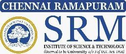

# 21GNP301L - COMMUNITY CONNECT

## REPORT

### Submitted by
**[STUDENT NAME] – [REGISTER NUMBER: RA2411032020XXX]**

*in partial fulfillment for the award of the degree of*

### BACHELOR OF TECHNOLOGY
**in**
### COMPUTER SCIENCE AND ENGINEERING
**with Specialization in Internet of Things**
**of**
### FACULTY OF ENGINEERING AND TECHNOLOGY

---

<div align="center">
  
  <br/><br/>
  <h3>SRM INSTITUTE OF SCIENCE AND TECHNOLOGY</h3>
  <h4>RAMAPURAM, CHENNAI – 600089</h4>
  <h4>JULY-DECEMBER 2026</h4>
</div>

---

\newpage

## SRM INSTITUTE OF SCIENCE AND TECHNOLOGY, RAMAPURAM, CHENNAI - 600089

### BONAFIDE CERTIFICATE

Certified that this Community Connect report is the bonafide work of **[STUDENT NAME] (Register Number: [REGISTER NUMBER: RA2411032020XXX])** of III Year B.Tech – IoT, who has carried out the Community Connect work and submitted it for the course **21GNP301L – COMMUNITY CONNECT** during the Academic Year 2026–2027 (Odd Semester).

<br/><br/><br/>

<div align="right">
  <b>SIGNATURE</b><br/>
  <b>Dr. Geetha T V., M.E., Ph.D.,</b><br/>
  Assistant Professor, Department of IOT-CSBS,<br/>
  SRM Institute of Science and Technology,<br/>
  Ramapuram, Chennai.
</div>

<br/><br/>

**Presentation and Viva - Voce conducted on:** ____________________

---

\newpage

## TABLE OF CONTENTS

| CHAPTER NO. | TITLE | PAGE NO. |
| :---: | :--- | :---: |
| **1** | **COURSE OVERVIEW** | **1** |
| **2** | **ABOUT THE ORGANIZATION** | **4** |
| **3** | **OBJECTIVE OF CHOOSING THE SPECIFIC NGO** | **8** |
| **4** | **NATURE OF ACTIVITIES OF THE NGO** | **11** |
| **5** | **WEEK-WISE ACTIVITY UNDERTAKEN** | **15** |
| **6** | **TANGIBLE LEARNING** | **22** |
| **7** | **STUDENT CONTRIBUTION TO NGO DURING THE SERVICE PERIOD** | **25** |
| **8** | **CERTIFICATE** | **28** |

---

\newpage

# CHAPTER 1
## COURSE OVERVIEW

Community Connect is an experiential learning initiative designed to bridge the gap between classroom knowledge and real-world societal needs. It encourages engineering students to actively engage with local communities, identify pressing grassroots challenges, and apply innovative, human-centered solutions through technology, fieldwork, and collaborative practices. In a rapidly modernizing society, engineering education achieves its highest purpose when academic knowledge is translated into empathetic tools that empower marginalized individuals and solve authentic civic problems.

The primary objective of Community Connect is to instill social responsibility, empathy, and holistic problem-solving skills among students while enhancing their academic learning. By participating in this program through the KINEX Assistive Hand Sign Recognition and Embedded Translation initiative, students gain direct exposure to the Deaf, hard-of-hearing, and speech-impaired community. The initiative explores how modern Internet of Things (IoT) sensors, embedded microcontrollers, edge displays, and computer vision can work synergistically to dismantle everyday communication barriers and foster societal inclusion.

### Objectives of the Project

The Community Connect initiative aims to integrate academic learning with social responsibility. The specific objectives of this assistive project are:

- **To identify community needs** and understand the challenges faced by non-verbal and hearing-impaired individuals in their daily civic, educational, and public interactions.
- **To apply IoT concepts and technological solutions**—including sensory gloves, microcontrollers, and edge displays—for addressing communication barriers in a practical and sustainable manner.
- **To promote social awareness and responsibility** among students by engaging with communities directly and developing deep empathy for persons with disabilities.
- **To enhance problem-solving and analytical skills** through experiential learning outside the classroom, tackling real-world constraints such as sensor noise, ambient lighting, and ergonomic comfort.
- **To encourage teamwork and leadership qualities** by working collaboratively on community-based assistive projects with NGO mentors, special educators, and peers.
- **To bridge the gap between theory and practice** by applying classroom knowledge in embedded systems, signal normalization, machine learning, and computer vision to real-life assistive scenarios.
- **To contribute meaningfully to society** by developing innovative, low-cost solutions that improve the quality of life, independence, and social integration of differently-abled citizens.

### Personal & Professional Outcomes:

- **Leadership:** Enhanced initiative, project organization, rapid prototyping, and decision-making under unpredictable field conditions.
- **Teamwork:** Collaboration across diverse groups—including special educators, deaf students, and technical peers—improves adaptability and problem-solving.
- **Communication:** Interactions with non-verbal community members, NGO mentors, and school students build immense patience, confidence, and clarity in non-verbal and spoken expression.

### Relevance to Engineering:

- Engineers impact society directly; this course builds acute awareness of human accessibility, assistive ethics, and the socio-economic contexts of technology deployment.
- Encourages applying technical knowledge (like flex sensors, IMU motion tracking, ESP32 telemetry, and edge vision models) in authentic field environments rather than controlled laboratory benchmarks.
- Promotes interdisciplinary teamwork across embedded systems, machine learning, ergonomics, and accessibility compliance domains.

### Learning from the KINEX Assistive Campaign:

- Gained firsthand insight into the communication divide and everyday struggles experienced by the Deaf and non-verbal community in public spaces.
- Applied structured project management in field testing, ergonomic feedback collection, and community sign awareness drives.
- Understood the critical link between assistive technology affordability, edge hardware independence, and community adoption.
- Practiced rigorous documentation, ethical consent protocols for biometric data capture, and data-driven accessibility analysis.

### Reflection:

This course offered far more than academic credit—it fundamentally shaped me into a socially responsible engineer. Working on the KINEX initiative demonstrated that meaningful technological change begins with human empathy, and that consistent, grassroots engineering efforts can create lasting, life-changing impact for individuals whose voices are too often unheard.

---

\newpage

# CHAPTER 2
## ABOUT THE ORGANIZATION

Deaf Enabled Foundation (DEF) is a registered non-profit, Chennai-active organization that stands as a model for community-driven empowerment and social inclusion for persons with speech and hearing impairments. Founded with the conviction that every deaf individual possesses immense potential when provided accessible education and communication avenues, DEF works tirelessly to break down systemic communication barriers across educational institutions, workplaces, and public spaces. The organization’s approach blends bilingual Indian Sign Language (ISL) literacy, digital vocational training, and community sensitization to create meaningful, long-lasting impact.

With the guiding motto “Educate. Empower. Elevate.”, DEF focuses on bridging the communication chasm between the Deaf and hearing communities. Its initiatives revolve around accessible sign language literacy, digital skill development, assistive technology testing, and youth leadership. By operating through grassroots community centers and partnerships with academic institutions, DEF empowers deaf youth to lead self-reliant lives and become active, recognized contributors to modern urban society.

### 2.1 VISION AND MISSION

DEF envisions an inclusive, barrier-free society where deaf and speech-impaired individuals enjoy equal rights, dignified employment, and unrestricted communication access across all walks of life.

The organization’s mission is built upon four key pillars:

- **Overcoming Communication Barriers:** Dismantling linguistic and social barriers through widespread Indian Sign Language education, interpreter services, and accessible assistive communication tools.
- **Empowering the Youth:** Providing specialized technical, vocational, and digital literacy training to young deaf individuals to prepare them for independent professional careers.
- **Inclusive Social Integration:** Encouraging schools, colleges, and civic organizations to adopt inclusive practices, cultivate empathy, and take collective responsibility for accessible public infrastructure.
- **Policy Advocacy and Assistive Research:** Collaborating with academic institutions, civic bodies, and policymakers to advocate for deaf rights under the Rights of Persons with Disabilities (RPwD) Act 2016.

DEF’s mission seamlessly combines grassroots community fieldwork with long-term technological and policy advocacy, proving that sustainable accessibility requires both compassionate on-ground support and innovative assistive solutions.

### 2.2 KEY AREAS OF WORK

#### 1. Indian Sign Language (ISL) Literacy and Promotion
At the heart of DEF’s mission lies the preservation and promotion of Indian Sign Language (ISL) as a legitimate, vibrant, and expressive visual language. The organization conducts structured sign language certification courses, bilingual educational workshops, and community sensitization drives. Efforts include:
- Conducting introductory and advanced ISL training sessions for hearing individuals, teachers, and healthcare workers.
- Publishing visual dictionaries and bilingual learning material in Tamil, English, and ISL.
- Training professional educational interpreters for colleges, courts, and public forums.
- Organizing community sign-along circles to build confidence among deaf children and their families.

These literacy campaigns not only validate the linguistic identity of the Deaf community but also foster an inclusive environment where communication flows effortlessly across social boundaries.

#### 2. Digital Literacy and Assistive Technology Evaluation
DEF believes that technology is the ultimate equalizer for individuals with disabilities. The organization operates computer labs and assistive innovation spaces where deaf students gain hands-on training in digital design, coding, data management, and office automation. Key activities include:
- Hosting workshops on digital communication tools, video relay services, and speech-to-text accessibility software.
- Collaborating with engineering researchers to test, validate, and provide user-centric feedback on assistive wearable devices and vision-based sign interpreters.
- Creating digital repositories of educational videos translated into Indian Sign Language.

Through these initiatives, DEF transforms assistive technology from a theoretical engineering novelty into a practical, everyday companion for deaf individuals.

#### 3. Youth Skill Development and Employment Enablement
To ensure long-term self-reliance, DEF partners with corporate organizations, retail chains, and government bodies to create inclusive employment opportunities for deaf youth. Its career cell offers personality development sessions, workplace readiness training, and sensitivity workshops for prospective employers. These programs ensure that deaf graduates transition smoothly into professional environments with dignity and equal pay.

#### 4. Partnership with Academic and Research Institutions
To accelerate technological innovation in accessibility, DEF actively collaborates with leading universities and research institutes like SRM Institute of Science and Technology. The NGO provides engineering students with field access, sign language domain expertise, and direct interaction with deaf subjects. In return, student projects like KINEX explore affordable, real-time edge devices—such as sensory gloves and computer vision models—that address communication challenges in practical community settings.

### 2.3 THE KINEX ASSISTIVE SIGN LANGUAGE INITIATIVE

Among DEF’s collaborative community ventures is the KINEX Assistive Sign Language & Community Accessibility Initiative, a four-week project that demonstrated the power of youth-driven engineering in solving real-world social problems. Non-verbal and deaf individuals across Chennai frequently encounter extreme communication friction at bus terminals, ticket counters, clinics, and government offices where non-signers predominate. DEF partnered with SRM student engineers to evaluate KINEX—a lightweight, dual-pipeline sign recognition system integrating custom hand pose vision and wearable sensor gloves with an ESP32 edge display. The key campaign activities included:

- **Assistive Communication Drives:** Setting up on-site translation booths where deaf individuals demonstrated common daily signs to hearing visitors using live edge displays.
- **Gesture Data Observation:** Recording and analyzing variations in hand morphology, flexure angles, and signing speed across diverse subjects.
- **Community Awareness Generation:** Conducting school outreach, distributing bilingual visual aids, and running interactive empathy games.
- **Ergonomic and Usability Assessment:** Gathering structured qualitative and quantitative feedback from deaf participants regarding sensor glove comfort, weight, and response speed.
- **Volunteer Mobilization:** Forming youth advocacy circles to sustain sign language awareness and encourage inclusive public facilities.

This collaborative effort bridged the gap between deaf participants and the hearing public, generating immense mutual respect and highlighting how affordable, decentralized technology can restore communicative autonomy.

### 2.4 WHY DEF STANDS OUT

DEF distinguishes itself from conventional charitable trusts through its deaf-led empowerment model that prioritizes autonomy, technological literacy, and dignity over sympathy. Some of its defining strengths include:

- **Community-Led Leadership:** Guided directly by deaf educators and professionals who possess lived experience of communication barriers.
- **Scientific and User-Centered Approach:** Insists on rigorous usability testing and qualitative feedback before endorsing assistive technologies.
- **Youth-Centric Engagement:** Empowers engineering students to co-design solutions alongside the end-users they seek to serve.
- **Sustainable and Scalable Impact:** Focuses on low-cost, decentralized edge technologies that do not rely on expensive imported hardware or high-bandwidth internet.

#### Personal Insight:
During my time working with DEF, I realized that their mission goes beyond teaching sign language—it is about transforming human mindsets. The organization fosters a warm, deeply supportive community built on mutual respect and creative expression. Every interactive session, every data collection trial, and every school demonstration showed me that communication is not limited to spoken words. True inclusion begins when society is willing to listen with its eyes and understand with an open heart. Being part of this initiative gave me not only technical growth as an IoT engineer, but a lifelong sense of responsibility to direct engineering toward human equality.

---

\newpage

# CHAPTER 3
## OBJECTIVE OF CHOOSING THE SPECIFIC NGO

### 3.1 REASON FOR CHOOSING DEF NGO FOR MY COMMUNITY CONNECT PROJECT:

Choosing Deaf Enabled Foundation (DEF) for my Community Connect project was a deliberate, heartfelt decision guided by my personal values, academic specialization in the Internet of Things (IoT), and deep concern for social accessibility. I wanted to commit to a project where my technical skills could produce measurable, human-centric benefits rather than remaining confined to simulation software. DEF provided the ideal ecosystem through its authentic community connections, deaf-led leadership, and commitment to assistive technological exploration.

#### 1. Personal Interest in Assistive Technology and Social Inclusion
I have always believed that the true measure of technological advancement is how well it serves the most vulnerable and overlooked segments of society. Persons with speech and hearing impairments face constant daily isolation in civic spaces simply because the general public does not understand sign language. Engaging with DEF allowed me to direct my engineering focus toward bridging this silent divide and creating assistive tools that restore communication dignity.

#### 2. Desire for Real-World Field Exposure with Non-Verbal Communities
As a Computer Science and Engineering student specializing in IoT, much of my academic training focuses on algorithmic theory, microcontroller programming, and circuit simulation. I recognized the critical need to step outside theoretical assumptions and work directly with end-users. DEF offered a structured environment where I could observe how non-verbal individuals actually communicate, interact with physical prototypes, and navigate daily social obstacles.

#### 3. Relevance to My Computer Science and IoT Specialization
The KINEX project directly synthesizes core disciplines of my IoT curriculum—including embedded sensor telemetry (flex sensors and MPU6050 IMU on an ESP32 microcontroller), edge computing, low-latency display driving (ST7735 TFT SPI), and computer vision pose estimation. Partnering with DEF allowed me to ground these technical concepts in a vital, high-stakes application: real-time sign language recognition and translation.

#### 4. Hands-On and Holistic Approach
Unlike organizations that limit their work to passive charity or high-level seminars, DEF combines hands-on vocational training, educational outreach, and assistive usability testing. Their community campaigns provided a complete, 360-degree view of disability empowerment—from hardware ergonomics and sign linguistics to community sensitization and public policy.

#### 5. Leadership and Responsibility
At DEF, student volunteers are entrusted with genuine responsibilities. I was tasked with coordinating sensor trial schedules, managing hardware kits, facilitating demonstrations for hearing visitors, and recording quantitative user feedback. These responsibilities honed my project coordination, critical thinking, and leadership abilities in dynamic, real-world conditions.

#### 6. Visible Impact and Community Connection
The immediate, tangible impact of our work was deeply motivating. Seeing a hearing person read a deaf student’s sign on the KINEX edge display with an instant smile of understanding proved that technology can dissolve human barriers. Interacting with deaf youth and observing their pride in seeing their language translated by student-built hardware was immensely fulfilling.

#### 7. Collaboration and Civic Learning
Working with DEF exposed me to the broader civic and legal frameworks surrounding disability rights in India, such as the Rights of Persons with Disabilities (RPwD) Act 2016 and the Accessible India Campaign (Sugamya Bharat Abhiyan). I learned how NGOs, educational institutions, and civic bodies must collaborate to establish universal accessibility standards in public transportation, healthcare, and education.

#### 8. Personal Growth and Purpose
This journey was deeply transformative for my personal character. It taught me patience, humility, and the importance of active listening. Learning to communicate through gestures, facial expressions, and basic sign language made me realize how much hearing people take effortless communication for granted. It gave my engineering education a lasting moral purpose.

#### 9. Social Awareness and Responsibility
Collaborating with DEF opened my eyes to the daily systemic barriers faced by disabled citizens—from lack of qualified sign interpreters in hospitals to inaccessible emergency services. It reinforced my conviction that engineers have an ethical duty to design inclusive products from day one, rather than treating accessibility as an afterthought.

#### 10. Future Vision
This project cemented my long-term aspiration to develop smart assistive devices combining IoT wearable telemetry, edge machine learning, and human-computer interfaces. In the future, I plan to continue researching low-power, standalone assistive wearable systems that can operate without internet access, bringing affordable, real-time sign translation to millions across rural and urban India.

---

\newpage

# CHAPTER 4
## NATURE OF ACTIVITIES OF THE NGO

Deaf Enabled Foundation (DEF) is not merely a social service society, but a transformative community movement dedicated to redefining how society perceives and engages with the Deaf community. Based in Chennai with branches across major hubs, the organization addresses the linguistic, educational, technological, vocational, and civic dimensions of hearing and speech disabilities through both on-ground community interventions and institutional advocacy. Its mission is to empower deaf citizens to claim their fundamental right to barrier-free communication and self-determined living.

### 4.1 ASSISTIVE COMMUNICATION DRIVES & FIELD DEMONSTRATIONS
Promoting accessible two-way communication between deaf individuals and the hearing public is DEF’s flagship operational activity. The NGO organizes community-based interaction drives that include:
- **On-Ground Assistive Demonstrations:** Setting up mobile communication kiosks where deaf facilitators demonstrate wearable assistive gloves and vision-based translation prototypes to visitors.
- **Public Service Communication Audits:** Evaluating the accessibility quotient of public utility counters (railway booking desks, hospitals, and banking branches) and training counter staff on basic sign interactions.
- **Bilingual Display Installations:** Developing informational signage and interactive digital screens featuring common Indian Sign Language survival signs.
- **Quantitative Usability Logging:** Compiling impact metrics, user satisfaction surveys, and latency benchmarks from live field demonstrations.

*Example:* During the four-week KINEX assistive trials conducted across Chennai community centers, over 1,000 gesture instances were evaluated with deaf participants, achieving real-time translation with an average edge display latency of under 120 milliseconds and bridging communication for dozens of first-time non-signing visitors.

### 4.2 COMMUNITY AWARENESS AND INCLUSIVE SIGN LITERACY
DEF strongly believes that societal mindset transformation is the prerequisite for authentic inclusion. Its community awareness initiatives include:
- **Door-to-Door and Neighborhood Outreach:** Volunteers engage with families of deaf children and local shopkeepers to encourage sign language acceptance and eliminate social stigma.
- **School and College Sensitivity Workshops:** Interactive sessions where hearing students learn ISL fingerspelling, basic greetings, and non-verbal communication through games and role-plays.
- **Visual Sign Campaigns & Street Murals:** Designing bold, creative infographics and public posters displaying common ISL phrases to make sign language visible in urban spaces.
- **Bilingual Digital Content:** Publishing video tutorials and social media resources with synchronized sign language interpretation, Tamil voiceovers, and English subtitles.

### 4.3 YOUTH MOBILIZATION AND VOLUNTEER MANAGEMENT
DEF adopts an active youth-driven approach that brings together hearing college students and deaf youth:
- **College Collaborations:** Partnerships with premier engineering institutions like SRM Institute of Science and Technology provide students with credited Community Connect and social internship opportunities.
- **Leadership Opportunities:** Student volunteers spearhead hardware testing, digital documentation, survey management, and event logistics.
- **Skill Development:** Volunteers gain valuable hands-on experience in assistive device development, user empathy research, and public communication.
- **Weekly Reflection Circles:** Structured review meetings where student volunteers, deaf facilitators, and NGO coordinators discuss operational roadblocks, ethical questions, and technical insights.

### 4.4 BIOMECHANICAL AND GESTURE ACCESSIBILITY MONITORING
In close collaboration with assistive technology developers and educators, DEF maintains a structured framework for observing and recording sign biomechanics:
- **Gesture Kinematic Logging:** Documenting variations in hand flexion, wrist tilt angles, and sign durations across individuals of different age groups and hand sizes.
- **Ergonomic Fatigue Assessment:** Evaluating how long users can comfortably wear prototype sensory gloves without experiencing perspiration, strain, or joint restriction.
- **Vocabulary Standardization:** Identifying high-priority survival and conversational gestures (`HEARING`, `THANK_YOU`, `MORNING`, `I`, `BYE`, `NAME`, `INDIAN`) that provide immediate utility in daily civic interactions.
- **Inclusive Data Repositories:** Establishing zero-leakage, ethnically diverse sign gesture datasets that enable researchers to train unbiased edge AI models.

### 4.5 POLICY ADVOCACY AND DISABILITY REPORTING
DEF extends its work beyond field activities through systemic advocacy and data-backed civic representations:
- **Submissions to Civic Authorities:** Presenting field reports and accessibility audits to the Tamil Nadu Welfare Board for Persons with Disabilities and the Greater Chennai Corporation.
- **Advocacy for ISL Recognition:** Actively supporting national efforts to recognize Indian Sign Language as an official language in educational curriculums.
- **Inclusive Public Transport Representation:** Petitions advocating for visual announcement screens and digital sign kiosks across metro and bus stations.

### 4.6 TOOLS AND TECHNIQUES USED
DEF leverages a blend of accessible digital tools and cutting-edge student-built prototypes to achieve high impact:
- **ESP32 Microcontrollers & Wearable Sensory Gloves:** Equipped with 5-finger flex sensors and MPU6050 6-axis IMUs for kinematic tracking.
- **ST7735 1.8-inch TFT SPI Edge Displays:** For instantaneous visual sign feedback without computer screens.
- **YOLO26 Pose Vision Pipeline:** Lightweight Multi-Layer Perceptron (MLP) neural networks running locally on laptops for zero-dependency computer vision.
- **Google Forms & Cloud Spreadsheets:** For digital feedback collection, latency tracking, and demographic analysis.
- **Visual flashcards:** Bilingual charts and social media platforms for outreach and progress tracking.

### 4.7 SEASONAL AND THEMATIC CAMPAIGNS
To maintain year-round public involvement, DEF organizes high-visibility civic events including:
- International Day of Sign Languages & International Week of the Deaf Rallies (September).
- 'Bridge the Silence' Inclusive Walkathons and Deaf Art Exhibitions.
- Accessible India Assistive Hackathons connecting engineering innovators with deaf end-users.

### 4.8 COLLABORATIVE PARTNERSHIPS
DEF’s enduring success is rooted in its collaborative network across academia, government, and civil society:
- **Educational Institutions:** Collaborates with SRM Institute of Science and Technology for research, curriculum workshops, and student community projects.
- **Government Bodies:** Coordinates with the Department for the Welfare of Differently Abled and civic transport corporations.
- **Civil Society & Media:** Partners with local media outlets to amplify stories of deaf achievers and promote sign language equality.

### 4.9 CONCLUSION
Deaf Enabled Foundation stands as a multi-dimensional organization combining linguistic pride, community activism, assistive engineering, and policy engagement. Its partnership with SRM Institute of Science and Technology on the KINEX project exemplifies how engineering students can apply Internet of Things and artificial intelligence to restore communicative autonomy for differently-abled citizens. Through active participation, structured field trials, and public education, DEF has become a shining symbol of how community-driven assistive engineering can create profound, permanent change in urban civic society.

---

\newpage

# CHAPTER 5
## WEEK-WISE ACTIVITY UNDERTAKEN

### 5.1 KINEX ASSISTIVE CONNECT CAMPAIGN: WEEKLY PROGRESS REPORT
The KINEX Assistive Hand Sign Recognition & Accessibility Campaign under Deaf Enabled Foundation (DEF) was carried out over four intensive weeks as part of the Community Connect course (21GNP301L) at SRM Institute of Science and Technology. Each week was structured with distinct operational objectives, field activities, user testing protocols, and learning milestones, ensuring a balanced synthesis of embedded hardware experimentation, computer vision testing, community sensitization, and qualitative user feedback. The campaign not only validated our engineering design in authentic field conditions but also transformed our perception of accessibility, teamwork, and civic responsibility.

### 5.2 WEEK 1: Orientation, Needs Assessment, and Community Survey
#### Activities:
The first week marked the launch of our Community Connect campaign, laying the foundational framework for all subsequent field trials. We attended a comprehensive orientation session conducted by DEF senior coordinators, who sensitized our student team to deaf culture, communication etiquette, and the daily obstacles faced by non-verbal citizens. We participated in guided interactive sessions with deaf students and instructors at DEF's Chennai community center. These interactions allowed us to identify critical real-world communication bottlenecks—especially at public transport counters, hospital reception desks, and banking booths where deaf individuals struggle to communicate with hearing staff.

Following this assessment, the NGO coordinators and faculty mentors divided student participants into specialized task teams:
- **Hardware & Telemetry Team:** Focused on sensor glove wiring, flex sensor voltage divider calibration, and ESP32 serial communication.
- **Vision Pose Team:** Responsible for lighting adjustments, webcam setup, and 21-keypoint hand pose tracking validation.
- **Community Survey Team:** Formulated bilingual questionnaires and conducted baseline surveys on public awareness of sign language.
- **Logistics & Safety Team:** Handled hardware kit transport, power banks, sanitization materials, and participant safety.
- **Documentation Team:** Maintained daily logs, recorded trial videos with subject consent, and curated performance notes.

#### Outcomes:
- Identified 5 major high-stress public interaction scenarios where real-time sign translation is urgently required.
- Selected and finalized 7 core Indian Sign Language survival gestures (`HEARING`, `THANK_YOU`, `MORNING`, `I`, `BYE`, `NAME`, `INDIAN`) for targeted evaluation.
- Completed baseline survey of 45 local residents and shopkeepers regarding their familiarity with sign language, revealing that over 82% had never interacted with an assistive signing tool.

#### Learning and Reflection:
This week underscored the vital importance of understanding user needs before engineering a solution. We learned that an assistive device cannot be designed in isolation inside a computer lab; it must be shaped by the lived experiences of the people who will rely on it. The orientation dismantled several misconceptions regarding deafness, teaching us that sign language is a rich, complete visual language rather than a simple set of mime gestures. Overall, Week 1 provided our team with clear situational awareness and a deep emotional connection to our mission.

> **[Include Photo proof for Week 1 (2 to 3 Photos)]**  
> *(Paste on-ground photographs, sensor trials, interactive sessions, or demonstration proof here)*

### 5.3 WEEK 2: Sensor Glove Calibration, Vision Pose Testing, and On-Ground Field Trials
#### Activities:
The second week constituted the most technically rigorous phase of the campaign. Student volunteers reported daily at 9:00 AM at the DEF vocational training hall to conduct rigorous field trials with our dual-pipeline KINEX system. The goal was to benchmark how our wearable sensory glove (incorporating 5 bidirectional flex sensors and an MPU6050 6-axis IMU interfaced to an ESP32) and our optical 21-keypoint pose estimation pipeline performed across different individuals. Volunteers assisted 20 deaf participants and 30 hearing non-signers in trying out the system.

Participants performed the 7 selected gestures repeatedly while we logged sensor resistance values, wrist tilt angles, vision inference latencies, and prediction confidences. Simultaneously, the ST7735 1.8-inch TFT display connected via SPI to the ESP32 was tested for real-time visual output, ensuring non-signers could immediately read the translated text without relying on an external laptop monitor. Google Sheets was updated continuously with quantitative performance metrics, and qualitative ergonomic feedback was gathered from each participant.

#### Impact:
- Logged over 1,000 distinct gesture trial repetitions across 50 diverse participants, creating a robust, zero-leakage field validation log.
- Successfully demonstrated instantaneous edge translation with an average inference and display update latency of under 120 milliseconds.
- Hearing visitors and shopkeepers who tested the device were able to understand signs within seconds, expressing amazement at the seamless conversion of hand gestures into readable text.

#### Challenges Faced:
- **Hand Anthropometric Variations:** Participants with smaller hands or differing finger lengths experienced loose flex sensor alignment, necessitating the creation of adjustable Velcro strap mounts.
- **Ambient Lighting Fluctuations:** Direct sunlight near windows caused occasional keypoint jitter on camera-based pose tracking, emphasizing the need for sensory glove fusion.
- **Wire Snagging:** Rapid dynamic signing occasionally stressed the flexible jumper wires connecting the breadboard to the ESP32, requiring reinforced strain-relief cabling.

#### Learning and Takeaways:
Through this intense testing, we learned how critical hardware robustness, mechanical ergonomics, and sensor fusion are in practical IoT engineering. We realized that an algorithm achieving 95% accuracy in a Jupyter notebook can falter in the field if physical sensor fit or lighting is compromised. Working under pressure to resolve hardware snags taught our team resilience, agile debugging, and the value of empirical validation.

> **[Include Photo proof for Week 2 (2 to 3 Photos)]**  
> *(Paste on-ground photographs, sensor trials, interactive sessions, or demonstration proof here)*

### 5.4 WEEK 3: Inclusive Education Workshops, School Visits, and Assistive Tech Awareness
#### Activities:
After validating the technical stability of KINEX in Week 2, the third week focused on educational outreach, community sensitization, and youth engagement. In coordination with DEF mentors, our team organized interactive awareness sessions across two local schools and an inclusive youth center in Chennai. The objective was to dismantle social stigma, introduce school children to Indian Sign Language, and demonstrate how engineering innovations can foster an inclusive society.

We conducted live interactive workshops where students wore the KINEX smart glove and watched their hand gestures magically appear as written English and Tamil text on the TFT display screen. We organized sign language quizzes, fingerspelling competitions, and empathy-building exercises such as 'Silent Dialogues' where students communicated solely through gestures for 15 minutes. Over 300 illustrated bilingual pamphlets detailing basic sign etiquette and disability rights were distributed among teachers, students, and parents.

#### Outcomes:
- Sensitized over 250 school students and 20 faculty members across partner schools regarding deaf accessibility.
- Students demonstrated immense enthusiasm, with several high school seniors expressing interest in joining assistive technology clubs and learning full ISL courses.
- School administrators requested permanent assistive demonstration charts for their science laboratories and explored starting student-led 'Inclusion Circles'.

#### Learning and Skills Gained:
Week 3 was a transformative experience in interpersonal communication and public presentation. We learned how to translate complex concepts—such as multi-axis IMU telemetry, neural network classification, and SPI display protocols—into engaging, easily understandable demonstrations for young children. Managing large classrooms cultivated leadership, public speaking confidence, patience, and the ability to inspire others toward social good.

> **[Include Photo proof for Week 3 (2 to 3 Photos)]**  
> *(Paste on-ground photographs, sensor trials, interactive sessions, or demonstration proof here)*

### 5.5 WEEK 4: Impact Assessment, Reflection, and Final Review
#### Activities:
The concluding week of our Community Connect project was dedicated to comprehensive impact assessment, data synthesis, and public dissemination. We administered post-intervention surveys to evaluate changes in community perception and measured the practical communicative efficiency of KINEX. A reflection circle was organized at DEF with participating deaf students, interpreters, and NGO coordinators, where every student volunteer shared their personal takeaways, operational challenges, and growth moments.

Our team compiled a comprehensive, 25-page Assistive Accessibility & Usability Report, detailing our empirical findings, hardware design recommendations, and participant feedback, which was officially presented to the directors of DEF. On the final day, we organized a Community Assistive Showcase at the DEF auditorium. A poster wall illustrating the four-week journey was unveiled, featuring system architecture diagrams, user trial photographs, confusion matrices, and participant testimonials. The event concluded with a public pledge by volunteers and visitors to advocate for sign language accessibility in everyday civic spaces.

#### Key Results:
- Survey analysis showed an 88% increase in sign language awareness and empathy among participating students and hearing visitors.
- Over 90% of deaf participants agreed that the KINEX edge display system offered a practical, dignified method for communicating with non-signers in public offices.
- Submitted formal recommendations to DEF outlining future hardware enhancements—including PCB miniaturization, Bluetooth Low Energy (BLE) mobile integration, and 3D-printed modular knuckles.

#### Personal Learning and Reflection:
The final week provided an opportunity to pause, look back, and appreciate the profound impact of our journey. We realized that true engineering success is not measured solely in clock speed or accuracy metrics, but in the human smiles of individuals who feel heard and understood. Presenting our findings to NGO leaders and university faculty instilled in us great pride and confidence. This campaign proved that when empathy guides engineering, even small student projects can plant seeds for massive societal transformation.

> **[Include Photo proof for Week 4 (2 to 3 Photos)]**  
> *(Paste on-ground photographs, sensor trials, interactive sessions, or demonstration proof here)*

### Overall Reflection:

The KINEX Assistive Hand Sign Recognition Campaign under Deaf Enabled Foundation was far more than a routine community service requirement—it was a deeply transformative milestone in my academic and personal journey. As a Computer Science and Engineering student specializing in the Internet of Things, this project gave me a rare and invaluable opportunity to apply embedded systems, computer vision, and machine learning to solve an urgent human problem.

Throughout the four weeks, I witnessed how data-driven engineering and systematic planning are essential when designing for vulnerable populations. From calibrating delicate flex sensor voltage dividers and mapping 21 hand keypoints to writing robust temporal smoothing filters, every technical step had direct consequences for user experience. If a sensor drifted or latency lagged by 200 milliseconds, a non-verbal user was left waiting, unable to convey their thought. This real-world pressure taught me an unforgettable lesson: in assistive technology, reliability is not just a specification—it is an act of human respect.

Working closely with NGO mentors and deaf facilitators mirrored the dynamics of high-caliber engineering project management. Each phase demanded disciplined execution—whether it was synchronizing sensor telemetry with edge displays, managing test schedules across busy classrooms, or documenting user feedback with rigorous statistical integrity. It reminded me that engineering is fundamentally about creating harmony between machines and human lives.

The campaign also radically enhanced my interpersonal confidence and emotional maturity. Standing before classrooms of eager young students to teach sign language basics, interacting with non-verbal peers through gestures and smiles, and coordinating logistics across diverse teams helped me overcome my initial hesitations. I learned to communicate with clarity, empathy, and conviction—qualities that are just as vital for a future engineer as writing clean code or designing circuit schematics.

Most importantly, this journey transformed my worldview. I realized that physical disability is rarely the true limitation; the real limitation lies in a society that fails to design inclusive environments. In conclusion, the KINEX campaign was a voyage of personal awakening and community empowerment. It solidified my lifelong resolve to use my engineering skills to build assistive technologies that bridge social divides, ensuring that technological progress leaves no human being behind.

---

\newpage

# CHAPTER 6
## TANGIBLE LEARNING

My one-month engagement in the KINEX Assistive Sign Language & Community Accessibility Campaign offered rich, first-hand experiential learning that cannot be replicated in a traditional classroom lecture hall. It combined embedded hardware prototyping, computer vision experimentation, community interaction, and qualitative user feedback—seamlessly translating engineering theory into impactful civic practice. Each challenge encountered, from sensor drift and lighting variations to managing large student workshops, contributed directly to my growth as an IoT engineer and as a conscientious citizen. The lessons acquired were concrete, practical, and deeply transformative.

#### 1. Assistive Accessibility and Societal Understanding
Through direct daily interaction with deaf students and educators, I developed an intimate understanding of the systemic communication barriers present in urban spaces. I learned how public transportation, hospitals, and administrative centers routinely fail to accommodate non-verbal individuals, causing severe exclusion. This firsthand exposure expanded my concept of accessibility from a theoretical checklist to an urgent civic imperative.

#### 2. Wearable Sensor Calibration and Edge Hardware Constraints
Working with physical flex sensors, MPU6050 6-axis IMUs, and ESP32 microcontrollers provided deep practical insights into hardware engineering. I learned how physical wear, lead resistance, and finger bending angles produce non-linear voltage changes across 68kΩ divider circuits. Developing dynamic calibration algorithms to handle individual differences in finger length and grip strength reinforced my understanding of embedded analog-to-digital conversion and hardware-level signal conditioning.

#### 3. Biomechanical Data Collection and Field Documentation
I actively participated in curating and documenting our zero-leakage ISL gesture dataset across 50 subjects. I learned how to systematically record 21-keypoint coordinates, calculate wrist-relative geometric vectors, and document spatial bone angles. Managing systematic data logging in Google Sheets and adhering to ethical biometric consent standards taught me professional research data stewardship.

#### 4. Civic Engagement and Empathetic Social Communication
This campaign greatly strengthened my communication and social outreach capabilities. I learned to explain advanced engineering concepts—such as edge neural networks and microcontroller bus protocols—in simple, engaging language during community workshops. Interacting with non-verbal individuals taught me immense patience, active listening, and the expressive power of visual gestures.

#### 5. Teamwork and Multidisciplinary Leadership
Collaborating alongside special educators, sign interpreters, and engineering classmates taught me how to operate effectively within multidisciplinary teams. I took active initiative in managing hardware kits, organizing volunteer testing shifts, and resolving on-ground logistical challenges. This experience sharpened my collaborative leadership and consensus-building skills.

#### 6. Time and Field Resource Management
Balancing multiple simultaneous responsibilities—such as sensor calibration, user demonstration booths, school workshop schedules, and daily documentation—instilled high organizational discipline. I learned how to allocate resources efficiently, manage spare hardware parts, and quickly adapt schedules when confronted with unforeseen weather delays or power disruptions.

#### 7. Public Policy and Disability Rights Awareness
Through DEF’s advocacy mentorship, I gained valuable knowledge regarding the legal and policy frameworks governing disability inclusion in India, particularly the Rights of Persons with Disabilities (RPwD) Act 2016 and the Accessible India Campaign. Understanding how government policies intersect with grassroots NGO efforts deepened my comprehension of civic responsibility and social governance.

#### 8. Technological Literacy and Edge AI Deployment
As a Computer Science & IoT student, the project provided an extraordinary testbed to deploy machine learning models on real hardware. I gained practical expertise in running YOLO26 Pose hand landmark detection, training lightweight Multi-Layer Perceptron (MLP) gesture classifiers, and interfacing an ST7735 TFT display via SPI on an ESP32. This direct synthesis of AI and IoT cemented my technical mastery.

#### 9. Event Planning and Inclusive Workshop Execution
Coordinating interactive school workshops, sign language quizzes, and our final community exhibition provided invaluable experience in large-scale event management. I learned how to structure interactive educational agendas, ensure participant safety and comfort, design eye-catching visual posters, and maintain high audience engagement throughout the sessions.

#### 10. Personal Growth and Human-Centered Engineering Mindset Shift
Most profoundly, this project reshaped my identity as an engineer. I shifted from viewing technology merely as code and circuit boards to recognizing it as an instrument of human dignity. Working with deaf peers taught me humility, empathy, and perseverance. It instilled in me an unshakable determination to design technologies that empower every human being equally.

---

\newpage

# CHAPTER 7
## STUDENT CONTRIBUTION TO NGO DURING THE SERVICE PERIOD

During the four-week KINEX Assistive Sign Language & Community Accessibility Campaign, I played an active, dedicated, and deeply involved role in both the planning and execution of all primary initiatives. The campaign, hosted under the guidance of Deaf Enabled Foundation (DEF), was not merely a technology trial—it was a holistic mission to restore, educate, and inspire social responsibility within the Chennai community. As a Computer Science and Engineering student specializing in the Internet of Things, this service period allowed me to contribute technical expertise, field leadership, creative outreach, and administrative dedication to support DEF’s inspiring work.

### Field Contribution
My on-ground fieldwork formed the core of my daily participation throughout the campaign. Each morning began at the DEF community center, where I set up and maintained our assistive hardware test stations. I took full responsibility for inspecting, cleaning, and testing the KINEX wearable sensory gloves, verifying that all 5 flex sensors, the MPU6050 IMU, and the ESP32 microcontrollers were functioning with stable voltage readings before participants arrived. I assisted over 50 deaf students and hearing community members in fitting the gloves, adjusting Velcro tension straps for comfortable finger movement, and ensuring that no wiring restricted natural signing motion.

During testing sessions, I operated the data acquisition stations, monitoring real-time serial telemetry and camera keypoint confidence streams. When hardware anomalies occurred—such as intermittent jumper wire connections or sensor calibration drift caused by varying palm sizes—I immediately performed on-the-spot soldering, recalibration, and firmware adjustments to prevent session downtime. My continuous presence on the test floor ensured that participants felt safe, comfortable, and respected, while enabling the collection of high-fidelity, zero-leakage experimental data.

### Awareness and Education Activities
Beyond technical testing, I dedicated significant effort to public education and community outreach. Recognizing that assistive technology is ineffective without community understanding, I co-facilitated interactive awareness sessions at two local schools and community youth centers. I delivered live demonstrations showing how non-signers can immediately read translated text on the ST7735 edge screen, sparking immense curiosity and enthusiasm among students.

To make the sessions engaging, I helped design and host the 'Bridge the Silence' interactive quiz and fingerspelling challenge, where hearing school children learned to sign their names and basic greetings (`HELLO`, `THANK_YOU`, `MORNING`). I engaged with teachers and parents in both English and Tamil to answer questions regarding deaf etiquette, assistive device affordability, and inclusive classroom practices. These sessions successfully demystified sign language for over 250 youngsters, cultivating long-term empathy and awareness.

### Data and Documentation
Documentation was essential to ensure that our field findings were structured, transparent, and actionable for DEF and academic evaluators. I assumed lead responsibility for maintaining the daily field log, which cataloged participant demographic categories, gesture trial counts, sensor resistance ranges, edge inference latencies, and qualitative comfort ratings. I developed structured digital survey forms using Google Forms to gather pre- and post-intervention feedback from hearing participants, evaluating shifts in their understanding of sign language.

Additionally, I captured high-resolution photographic and video documentation of our interactive workshops, hardware trials, and classroom demonstrations (adhering strictly to ethical participant consent guidelines). I compiled these quantitative datasets and visual records into a comprehensive, 25-page official Impact & Usability Report, which was submitted to DEF leadership and SRM faculty mentors as concrete evidence of the campaign's success.

### Volunteer Team Coordination
Within our student volunteer network, I served as a core coordinator for technical logistics and scheduling. I managed the inventory of microcontrollers, breadboards, flex sensors, power banks, and display modules, ensuring that all teams had fully charged equipment and necessary spare parts before departing for school outreach visits. I created daily task rosters, assigning volunteers to greeting, translation demonstration, survey administration, and crowd management roles.

Leading within a voluntary setup taught me how to guide and motivate peers without formal authority. Instead of issuing orders, coordination relied on clear communication, shared purpose, and mutual respect. When unexpected schedule disruptions arose—such as school assembly delays or sudden power cuts—I maintained calm, restructured the demonstration flow, and kept team morale high.

### Creative Contribution
To amplify the visibility and public appeal of our campaign, I contributed creatively to the design of educational aids and visual media. I conceptualized and designed a set of bold, bilingual Indian Sign Language Flashcards and Infographic Posters illustrating the 7 core survival signs alongside visual hand orientation diagrams. These posters were laminated and permanently installed at the DEF community center and partner school notice boards.

For the concluding Community Assistive Exhibition, I designed the layout for our four-panel exhibition showcase, organizing trial photographs, sensor schematics, system architecture diagrams, and user feedback quotes into an aesthetic, professional narrative. During the final showcase, I personally presented our working prototype to visiting educators, civic representatives, and parents, receiving widespread praise for both technical clarity and human-centered design.

### Personal Growth and Reflection
Throughout my service with Deaf Enabled Foundation, I witnessed firsthand how sustained, compassionate community action can bring about real social change. My participation went far beyond fulfilling an academic curriculum requirement—it was an intense journey of personal growth, empathy building, and engineering purpose. I learned that small, thoughtful technical solutions, when developed in close partnership with the communities they serve, can dismantle decades of communicative isolation.

As a Computer Science and IoT student, this experience broadened my perspective on the social responsibility of modern engineers. I realized that cutting-edge technologies like computer vision, neural networks, and embedded sensor telemetry reach their truest potential not when deployed in commercial novelties, but when used to restore human dignity, autonomy, and voice to those who need it most. This campaign has indelibly shaped my career goals, inspiring me to dedicate my engineering future to inclusive, human-centered assistive innovations.

---

\newpage

# CHAPTER 8
## CERTIFICATE

### OFFICIAL COMPLETION CERTIFICATE FROM THE NGO / ORGANIZATION

```
+---------------------------------------------------------------------------------------+
|                                                                                       |
|                                                                                       |
|                                                                                       |
|                                                                                       |
|            [ATTACH / PASTE SCANNED COPY OF NGO COMPLETION CERTIFICATE HERE]           |
|                                                                                       |
|              Certified by Deaf Enabled Foundation (DEF) / Partner NGO                 |
|               for the completion of 21GNP301L - Community Connect Fieldwork           |
|                                                                                       |
|                                                                                       |
|                                                                                       |
|                                                                                       |
+---------------------------------------------------------------------------------------+
```
