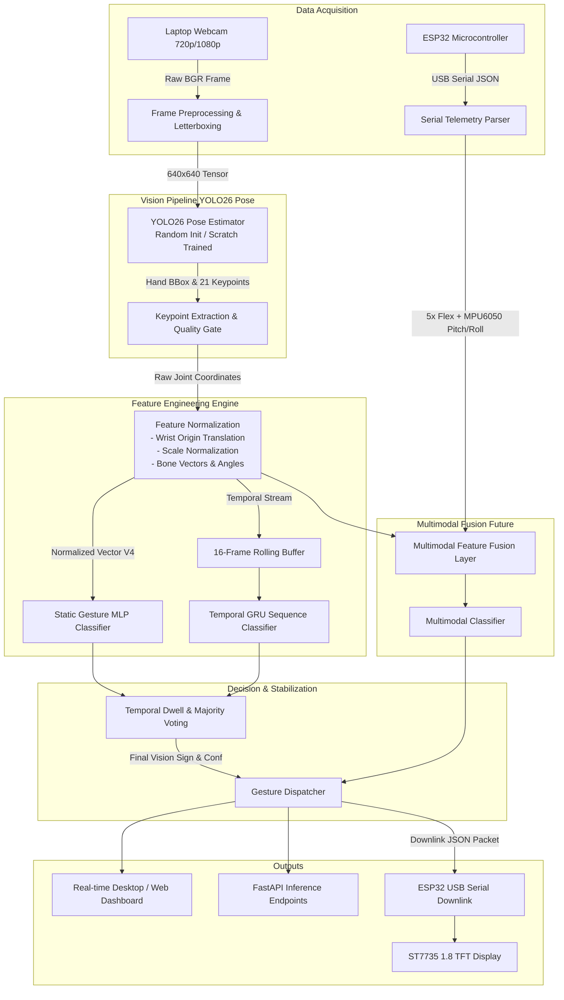

# KINEX — Technical Architecture Specification

## 1. High-Level System Architecture Diagram

---

## 2. Mathematical Formulation of Keypoint Feature Engineering

To achieve robust recognition under variable hand distances, image positions, and camera angles, raw pixel coordinates $[u_i, v_i]$ are transformed into an invariant representation.

### 2.1 Wrist-Centric Translation
Let $P_i = (x_i, y_i)$ be the 2D coordinate of keypoint $i \in \{0, 1, \dots, 20\}$, where $P_0$ is the wrist.
$$P'_i = P_i - P_0 \quad \forall i \in \{0, \dots, 20\}$$
By definition, $P'_0 = (0, 0)$.

### 2.2 Scale Invariance Normalization
Scale is normalized using a stable reference baseline: the Euclidean distance between the wrist ($P_0$) and the middle finger MCP joint ($P_9$, index knuckle base):
$$d_{\text{ref}} = \|P_9 - P_0\|_2 = \sqrt{(x_9 - x_0)^2 + (y_9 - y_0)^2}$$
If $d_{\text{ref}} < \epsilon$ (degenerate detection), palm width between index MCP ($P_5$) and pinky MCP ($P_{17}$) is used as fallback.
$$P''_i = \frac{P'_i}{d_{\text{ref}}} \quad \forall i \in \{0, \dots, 20\}$$

### 2.3 Bone Vectors and Joint Angles
For adjacent joints $(A, B, C)$ along any finger (e.g., MCP $\to$ PIP $\to$ DIP):
- Bone vector $\vec{v}_1 = P_B - P_A$
- Bone vector $\vec{v}_2 = P_C - P_B$
- Joint angle $\theta$:
$$\cos(\theta) = \frac{\vec{v}_1 \cdot \vec{v}_2}{\|\vec{v}_1\| \|\vec{v}_2\|}, \quad \theta = \arccos\left(\text{clip}\left(\frac{\vec{v}_1 \cdot \vec{v}_2}{\|\vec{v}_1\| \|\vec{v}_2\|}, -1.0, 1.0\right)\right)$$

### 2.4 Feature Vector Versions
1. **Version 1 (`v1_coords`)**: $21 \times 2 = 42$ normalized coordinates $P''_i$.
2. **Version 2 (`v2_bones`)**: 20 normalized directional bone vectors ($40$ values).
3. **Version 3 (`v3_angles`)**: 15 key finger flexion and abduction angles.
4. **Version 4 (`v4_combined`)**: Concatenation of normalized coordinates (42), bone unit vectors (40), and joint angles (15), yielding a rich 97-dimensional or 126-dimensional descriptor.

---

## 3. Real-Time Latency Budget

To maintain $\ge 25\text{ FPS}$ interactive throughput on standard laptop hardware:

| Component | Target Latency | Max Allowable Latency |
|:----------|:---------------|:----------------------|
| Frame Capture & Preprocessing | $3\text{ ms}$ | $5\text{ ms}$ |
| YOLO26n Pose Inference (CPU/GPU) | $20\text{ ms}$ | $30\text{ ms}$ |
| Feature Extraction & Normalization | $1\text{ ms}$ | $2\text{ ms}$ |
| Classifier Inference (MLP) | $<1\text{ ms}$ | $2\text{ ms}$ |
| Temporal Filter & Buffer Update | $<1\text{ ms}$ | $1\text{ ms}$ |
| UI Rendering & Overlay | $4\text{ ms}$ | $8\text{ ms}$ |
| **Total End-to-End Latency** | **$\le 30\text{ ms}$** | **$\le 48\text{ ms}$** |
